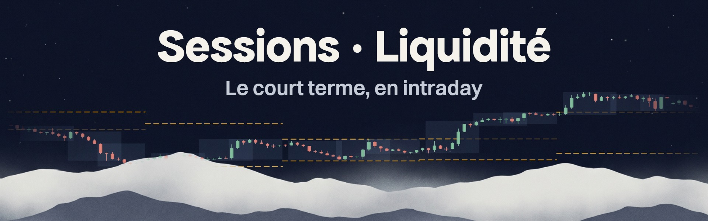

# Sessions · Liquidité

**Le court terme, en intraday.** Les séances, la liquidité au sens ICT et SMC, les zones H4 et les plans de la stratégie d'école de L'initiation, dans un seul indicateur TradingView. Pour le forex, l'or, la crypto et les indices.

Version 1.0 · [le guide complet](GUIDE.md) · [les versions](#versions)

**La liquidité, ici**, c'est celle de l'ICT et du SMC : les stops qui dorment au-delà des sommets et des creux évidents, déduits des prix seuls. Ce n'est pas de l'order flow : ni carnet d'ordres, ni volume acheteur ou vendeur, ni delta.

## En bref

- **Les séances** Asie, Londres et New York, en heure de Paris, avec leur haut, leur bas et leur POC.
- **La liquidité** : les hauts et bas d'hier, de la semaine, du mois et des séances, les sommets et creux égaux, les chiffres ronds, et la **cible de liquidité**.
- **Les zones H4** : FVG et order blocks.
- **Les sweeps BSL et SSL**, et en H1 les **plans** de la stratégie d'école, avec leur taille de position.
- **Le tableau** : le contexte du jour, et à cocher le plan en cours, le feu rouge et le bilan des plans passés.
- **En option** : la structure (BOS, CHoCH), le VWAP, le range d'ouverture et les ouvertures du jour et de la semaine.

## Installation

1. Ouvre l'**éditeur Pine Script** de [TradingView](https://tradingview.com/) : nouveau script de type indicateur.
2. Colle le contenu de [`Sessions_Liquidite.pine`](Sessions_Liquidite.pine), puis **Enregistrer** et **Ajouter au graphique**.
3. Dans le groupe **6 · Taille de position**, entre ton capital, la devise de ton compte et ton risque par trade.

Il ne prend qu'une place : sur le plan gratuit, il tient à côté d'EMA · RSI. Le numéro de version est dans son nom, en haut à gauche du graphique. Après une mise à jour du code, retire l'indicateur du graphique puis remets-le.

## Lire le graphique

Une couleur, un rôle : l'**ambre** pour la liquidité, le **vert** et le **rouge** pour le sens, l'**encre** pour les repères, la **teinte des séances** pour le temps.

| Repère | Ce qu'il dit |
|---|---|
| Fond léger, « Asie », « Londres », « New York » | Une séance, de son plus bas à son plus haut. Le fond fonce de 14 h à 18 h, quand Londres et New York se chevauchent |
| Trait d'encre, « POC Londres » | Le prix où la séance a échangé le plus de volume ; il avance tant que le prix n'est pas repassé dessus |
| Trait ambre fin, « Haut Asie » | Le haut ou le bas d'une séance finie |
| Tirets ambre, « Haut J-1 », « Bas S-1 » | Le haut et le bas d'hier (1 px), de la semaine passée (2 px), du mois passé (3 px) |
| Pointillés ambre, « Sommets égaux » | Deux sommets au même niveau : des stops ont toutes les chances d'y dormir |
| Trait très pâle, avec son prix | Un chiffre rond proche du prix |
| « Cible · Haut Asie » | La cible de liquidité : le niveau intact le plus proche dans le sens du daily |
| Une ligne qui s'arrête et pâlit | Le prix est allé chercher le niveau |
| Fond vert ou rouge | Une zone H4 d'achat ou de vente : plein pour un FVG, bordé pour un order block |
| **BSL** rouge, **SSL** vert | Un sweep dans le sens de l'EMA 200 daily : la mèche prend un sommet (BSL) ou un creux (SSL), la clôture revient en deçà |
| BSL ou SSL en gris | Le même sweep, à contre-sens : pas de plan |
| Trait d'encre, trait rouge, pointillés verts | Le plan : l'ordre stop, le stop, l'objectif à 2R |
| « +2R », « −1R » | Le résultat d'un plan exécuté, sans les frais |

Le survol d'un BSL ou d'un SSL dit quels niveaux la mèche a pris aussi, si elle touche une zone H4, et ce que son plan est devenu.

## Le tableau

En bas à droite, sous EMA · RSI, en trois parties qui se cochent une par une dans le groupe 8 :

- **Contexte**, affiché par défaut : le sens du daily, la cible de liquidité et sa distance, la tendance en weekly, H4 et H1, la séance, l'amplitude du jour et le prochain passage de la routine.
- **Plan**, à cocher : le feu rouge après deux pertes dans la journée (leçon 18), l'ordre, le stop, l'objectif, le risque et ses frais, la taille de position et la zone H4.
- **Bilan**, à cocher : les plans exécutés sur ce graphique, frais compris, et la pire série de pertes.

**Compact** ne garde que l'essentiel ; **Texte** le passe en petit.

## La stratégie d'école

Les six conditions de la leçon 16, en H1, à l'achat :

1. Daily au-dessus de l'EMA 200.
2. Le prix sur une zone H4 : support, OB, FVG.
3. Une mèche sous le dernier creux H1 intact, clôture au-dessus.
4. Achat stop 1 pip au-dessus du dernier sommet qui précède la mèche.
5. Stop 5 pips sous la mèche.
6. Objectif à 2R.

L'indicateur vérifie la 1, la 3, et la 2 pour les order blocks et les FVG ; un support reste à juger à l'œil. Il trace ensuite la 4, la 5 et la 6. À la vente, tout s'inverse.

L'ordre se pose au passage suivant de la routine : 8 h, 12 h 30 ou 18 h 30, heure de Paris, en semaine. Il s'annule après 24 heures, ou si le prix touche le niveau du stop avant l'entrée. Hors du forex, les 5 pips et le pip deviennent 0,46 et 0,09 ATR : la même règle, à la mesure de ce que bouge l'actif.

## Ce que disent les tests

Rejouée sur deux à trois ans de données horaires, avec les règles exactes de la leçon :

| Marché | Trades | Par trade | Marge du hasard |
|---|---|---|---|
| Forex, 8 paires | 664 | 0,00R | ±0,11R |
| Or, crypto et indices | 428 | +0,10R | ±0,14R |
| Forex, sur zone H4 | 471 | +0,04R | ±0,13R |
| Or, crypto et indices, sur zone H4 | 310 | +0,09R | ±0,16R |

Tous les résultats restent dans la marge du hasard, avec ou sans la zone H4 : **l'indicateur montre des setups, pas un avantage.** Il sert à apprendre l'exécution, au Replay comme en démo, et son bilan, à cocher dans le tableau, rejoue les mêmes règles sur ton propre graphique. Le détail, marché par marché et année par année : [`test/Résultats.md`](test/Résultats.md).

## Les alertes

Clic droit sur le graphique, **Ajouter une alerte**, condition **Sessions · Liquidité**, fréquence **Une fois par clôture de barre**.

- **Toute fonction alert()** : le plan complet dès qu'il est prêt, puis son exécution et sa sortie. Les niveaux pris, les sweeps et les zones touchées sont à cocher dans le groupe **9 · Alertes**.
- **Une par une** : Nouveau plan de trade, Sweep d'achat dans le sens, Sweep de vente dans le sens, Zone H4 touchée dans le sens, Haut ou bas d'hier pris, Haut ou bas de la semaine passée pris, Haut ou bas d'une séance pris, Cassure de structure.

## Les réglages

Les réglages par défaut suivent la leçon 16. À changer seulement si besoin :

| Réglage | Groupe | Quand le changer |
|---|---|---|
| Thème | Apparence | Le même que dans EMA · RSI |
| Noms à droite | Apparence | Essentiels par défaut ; Tous pour chaque niveau, Aucun pour un graphique nu |
| Heures des séances, range d'ouverture | 1 · Séances | Toujours en heure de Paris |
| Ouvertures, pas des chiffres ronds | 2 · Liquidité | Pour ajouter des niveaux |
| Zones affichées de chaque côté | 3 · Zones H4 | Deux par défaut ; toutes comptent pour la condition 2 |
| Cassures de structure | 4 · Structure | Pour voir les BOS et les CHoCH de la leçon 05 |
| Exiger une zone H4 | 5 · Stratégie d'école | Pour ne garder que les plans sur un OB ou un FVG |
| Frais par trade | 5 · Stratégie d'école | Pour que le bilan compte tes frais |
| Capital, devise, risque, taille d'un lot | 6 · Taille de position | Pour que la taille affichée soit la tienne |
| VWAP | 7 · VWAP | Sur les indices et la crypto |
| Plan, bilan | 8 · Tableau | Pour suivre le plan en cours, le feu rouge et le bilan des plans passés |
| Compact, texte | 8 · Tableau | Pour alléger le tableau, sur un petit écran surtout |

## Bon à savoir

- **Rien ne repeint** : tout se calcule à la clôture, et ce qui vient du daily, du weekly ou du H4 est pris à la clôture de leur bougie précédente.
- **Au Replay**, l'indicateur avance bougie par bougie comme en direct : plans, zones et bilan se construisent au fil de la lecture.
- **Des plans en H1 seulement**, par défaut : c'est l'unité de temps de la leçon et du test. Ailleurs, les sweeps restent affichés, sans plan.
- **Des bougies classiques** : en Heikin Ashi, les prix sont recalculés, et les plans comme le bilan ne veulent plus rien dire.
- C'est un outil d'apprentissage et de lecture, pas un conseil en investissement.

Tout le détail, réglage par réglage : [le guide complet](GUIDE.md).

## Versions

**1.0** · 7 novembre 2026 · Première version publique : les séances et leur POC ; la liquidité au sens ICT et SMC, avec la cible de liquidité ; les zones H4 ; la structure et le VWAP en option ; les sweeps BSL et SSL et les plans de la stratégie d'école, avec leur taille de position ; le bilan, le feu rouge et les alertes.

---

Un indicateur de [Cyberia](https://cyberiaclub.fr). Pour la tendance, son voisin : [EMA · RSI](https://github.com/Tomas-Cyberia/EMA_RSI).
